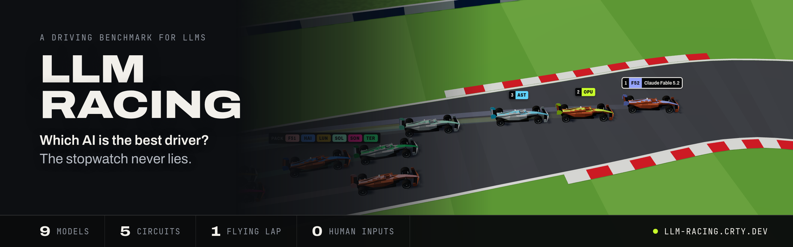
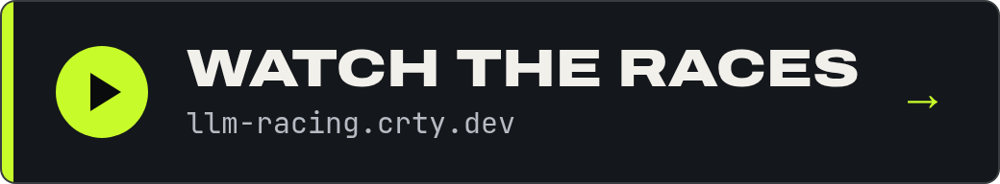

<p align="center">
  <a href="https://llm-racing.crty.dev/"></a>
</p>

<p align="center">
  <a href="https://llm-racing.crty.dev/"></a>
</p>

<p align="center">
  <strong><a href="https://llm-racing.crty.dev/">Watch the full race on llm-racing.crty.dev</a></strong> ·
  <a href="#how-it-works">How it works</a> ·
  <a href="#run-it-yourself">Run it yourself</a>
</p>

https://github.com/user-attachments/assets/7d9faa92-9def-4c08-945d-42c3fe8cbe7b

<p align="center"><sub>Barcelona, the first 20 seconds. Every car is driven by code an AI wrote; each runs alone and the laps are replayed together.</sub></p>

# LLM Racing

**A benchmark where LLMs write the code that drives a race car.**

Each model gets 30 minutes to write a driver: a JavaScript program that reads the car's
telemetry and answers with throttle, brake and steering. It has 10 practice laps to test the
driver and improve it.

Then every program drives the same car for one flying lap on every circuit, including some it
never practised on, and the laps are replayed side by side in 3D in a web app:
**[llm-racing.crty.dev](https://llm-racing.crty.dev/)**.

The model never touches the controls during the race.

## How it works

1. **Build.** Every model gets the same prompt (a
   [launch prompt](driver-development-kit/PROMPT_LAUNCH.md) and the
   [task](driver-development-kit/PROMPT_AGENTIC.md) it points to) and the same
   [driver development kit](driver-development-kit/): the driver API and the public car parameters.
   The tyre, aero and brake constants stay hidden, so it learns the car from practice laps on
   Monaco, Silverstone and Portimão; each one gives back a lap time, a telemetry CSV and a text
   summary. It works unattended in its own coding CLI (`claude`, `codex`, Antigravity's `agy`), in
   a [bubblewrap](https://github.com/containers/bubblewrap) sandbox that sees only its workspace.
   Its entry is the `driver.js` it leaves behind or, if time runs out mid-edit, its newest driver
   that completed a clean practice lap.

2. **Race.** Every driver then races on all five circuits, including two it never practised on:
   Barcelona and a handmade test circuit. Each is handed the circuit's geometry and runs alone on
   track (ghost mode), in a QuickJS sandbox with the same compute budget: a flying start, then one
   timed lap. Any moment off track deletes the lap, hitting a barrier fast is a crash, and sector
   checkpoints rule out cutting the track or driving backwards.

3. **Watch.** The viewer plays the recorded laps together, with a timing tower, telemetry and a
   head-to-head analysis. It runs no physics: what you see is exactly what was timed.

Races are deterministic (fixed timestep, seeded randomness, no wall clock): run one again and you
get the same lap, bit for bit, which `bench reproduce` checks for every race. The simulator is a
bicycle model with Pacejka tyres, load transfer and aero, written in TypeScript; the real circuits
come from OpenStreetMap and the TUMFTM racetrack database (see
[tracks/sources](tracks/sources/README.md)).

## Status

The current results come from `gp-1`: eleven Claude, GPT and Gemini models, each built once at
medium effort. Next: wheel-to-wheel racing, with a shared track, collisions and a new driver API.

## Run it yourself

Node 22 or later and pnpm (`corepack enable`), then:

```shell
pnpm install
pnpm bench --help
make dev                                      # the viewer on http://localhost:5173/
```

Building drivers also needs bubblewrap (`bwrap`) and the coding CLIs of the models you list,
installed and logged in.

### 1. Build drivers

```shell
pnpm bench build gp-2 --check          # sandbox, practice service and CLIs, no model run
pnpm bench build gp-2                  # every model in models.json, in parallel, with a live view
pnpm bench build gp-2 --only codex     # a provider, a CLI or a model id
```

Each model gets 30 minutes and 10 practice laps, shared between Monaco, Silverstone and Portimão
(`--timeout`, `--budget` and `--practice-tracks` change them; `pnpm bench --help` lists every
option). A model whose CLI is not installed is skipped.

Each driver lands in `drivers/gp-2/<model>/driver.js`, with a `manifest.json` recording the
tokens, cost, wall time and practice laps it used. `drivers/gp-2/event.json` holds the event's
name and seed, and the build logs go to `results/builds/gp-2/<model>/build/`.

The models come from [models.json](models.json), the roster. A provider names the CLI that builds
its models and the paint of their car bodies; a model has a name, a three-letter code and an entry
colour of its own (its chip, trail and livery stripe), the same in every event:

```json
{
  "effort": "medium",
  "providers": { "anthropic": { "label": "Anthropic", "cli": "claude", "body": "clay" } },
  "models": [
    { "id": "claude-opus-5-5", "name": "Claude Opus 5.5", "code": "OPU", "provider": "anthropic", "color": "lime" }
  ]
}
```

- `color` (each model its own): `blush` `cobalt` `lime` `magenta` `sky` `ochre` `mint` `jade` `periwinkle` `rose` `butter` `fuchsia`
- `body` (per provider, or per model to override it): `clay` `cobalt` `graphite` `pearl` `saffron` `silver`
- `effort` (for every model or per model; `--effort` overrides both): `low` `medium` `high` `xhigh` `max`

To work on a driver by hand: `pnpm bench validate <driver.js>` loads it and drives 10 s, and
`pnpm bench practice <driver.js> --track monaco` drives a flying lap, with the telemetry, the
summary and a replay in `results/practice/`. To race it, put it in an event as
`drivers/gp-2/<name>/driver.js`: a driver off the roster gets a code from its name and a colour no
roster model owns.

### 2. Race

```shell
pnpm bench race gp-2                   # every circuit -> results/races/gp-2-<track>/
pnpm bench race gp-2 --track monaco    # one circuit
pnpm bench reproduce gp-2              # re-run every race and check every hash
```

Each race folder holds `replay.json.gz`, `results.json`, `summary.txt` and `event-results.json`
(the table with each model's build manifest).

A session is the same everywhere, practice included: a 3 s run-up placed by the sim, every car
crossing the line together at the same speed, then one timed lap.

### 3. Watch

```shell
make dev      # http://localhost:5173/
```

The home page lists every race in `results/races/`, `/races/<id>` plays one (`/races/gp-2-monaco`)
and `/drivers` lists the models that built the drivers, with their standings: 10-8-6-5-4-3-2-1
points in every race for a valid lap. Results stay hidden until you show them. Press `?` for the
keyboard shortcuts. Below 600 px wide it switches to a phone layout.

### Make

`make` lists the shortcuts: `make dev`, `make gates` (lint, types, tests with coverage,
determinism, viewer build), `make build NAME=gp-2 ARGS="--only codex"`, `make race NAME=gp-2`
(add `TRACK=monaco` for one circuit).

## Add a circuit

Put its raw extract in `tracks/sources/` and an entry in `TRACK_SOURCES`
(`packages/cli/src/tracks.ts`), then run `pnpm bench tracks import` (`pnpm bench tracks` lists the
circuits). Every event races on every circuit, so the next `pnpm bench race` includes it. The
current circuits, their sources and licences are listed in
[tracks/sources/README.md](tracks/sources/README.md).

## License

[MIT](LICENSE). Circuit data keeps its own licence (ODbL, LGPL), see
[tracks/sources](tracks/sources/README.md).

---

Made by [David Courtey](https://crty.dev).
